<!--  -->

Can we just "vibe-engineer" actual analog circuits in hardware? When GPT-6 Astra and Claude Opus 5.5 were released in September 2026, it became quite clear that the models' capabilities in spatial reasoning and engineering in general had significantly improved. OpenAI even showed [a PCB designed by Astra](https://openai.com/index/gpt-6-astra/) in their announcement. I decided to put these capabilities to the test. I was quite astonished by the results and learned a lot about analog synthesizers along the way.

If you are interested in the final result and audio examples, feel free to browse the [repo](https://github.com/cpldcpu/TouchSynth/), read the AI-generated [design report](https://github.com/cpldcpu/TouchSynth/blob/master/docs/report/touchsynth_report.pdf) or check out the [AI-generated website](https://cpldcpu.github.io/TouchSynth/) with sound examples. Read on below for the human perspective.

<figure>
   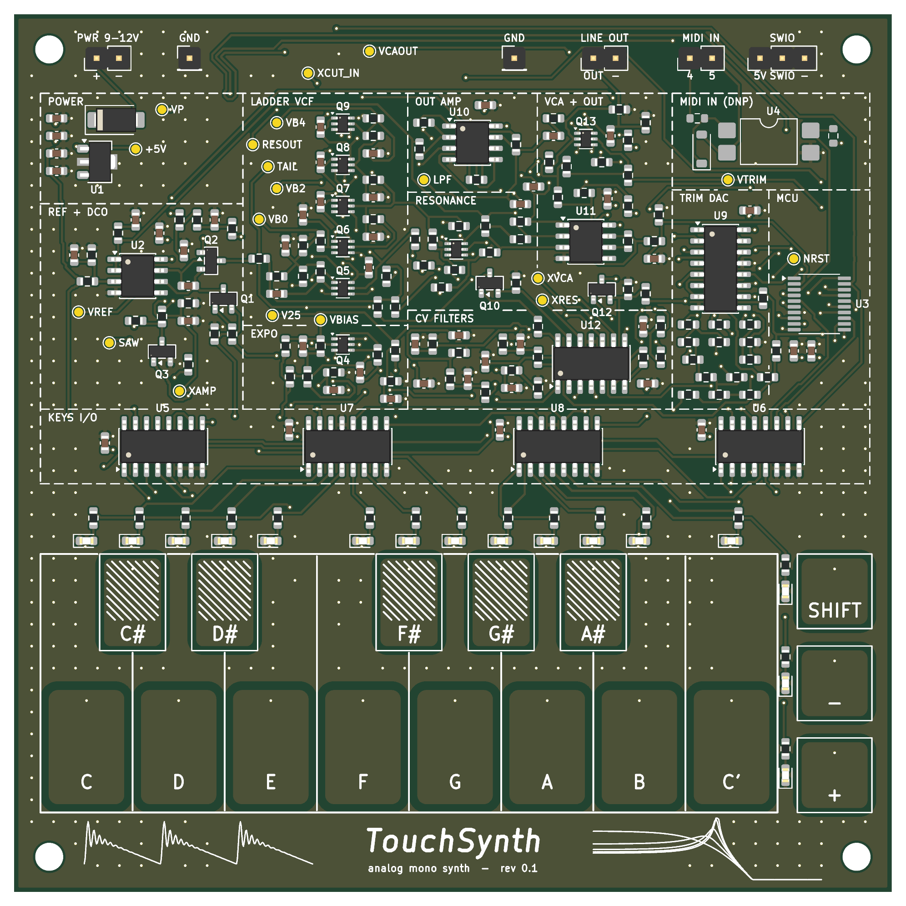
  <figcaption>PCB render</figcaption>
</figure>

## Setup

When working with full end-to-end GenAI designs I typically try to follow a systematic approach starting from the highest abstraction level (the [V-Model](https://en.wikipedia.org/wiki/V-model) may serve as a reference). I try to avoid "iterative editing" where I start to change things in earlier levels of the hierarchy. My observation is that it is much easier for the models to generate the next abstraction layer from a complete specification in one go, instead of doing it step by step. A likely reason is that this provides a more compact context for the model to work with. I also ask it to write a design report in parallel, typically either .md files in a folder or a LaTeX design report. Of course, this is proper engineering practice anyway. But when using AI it is very tempting to work by trial and error, which I found to be far less successful.

I used Claude Code with Opus 5.5 in VSCode, starting from a blank project folder and a fresh git repo. I pointed the agent to the JLCPCB free parts list and asked it to come up with suggestions of what could be built from them. After iterating on some boring options I suggested an MCU-controlled analog synthesizer with touch keys on the PCB, with little more input given than the MCU to be used (CH32V00x).

It suggested a [subtractive synthesizer](https://en.wikipedia.org/wiki/Subtractive_synthesis) with a [Juno-style digitally controlled oscillator (DCO)](https://electricdruid.net/roland-juno-dcos/), a [Moog-style transistor ladder filter](https://www.allaboutcircuits.com/technical-articles/analyzing-the-moog-filter/) and a voltage-controlled amplifier. 

## Design & implementation

I pointed Claude Code (CC) to KiCad 10 in the Windows environment and WSL for all Linux command line tools, specifically ngspice for circuit simulation, pdflatex for document generation, the RISC-V toolchain and of course Python. Almost everything is a Python script.

I asked it to design the circuit, simulate it in ngspice and write a [simulation report](https://github.com/cpldcpu/TouchSynth/blob/master/docs/sim_report.md). The agent built its own [component library](https://github.com/cpldcpu/TouchSynth/tree/master/sim/models) based on models sourced from the web. CC corrected some parts of the initial design based on the simulation results. To be able to simulate the whole synthesizer, I also asked it to come up with a behavioral model in Python and calibrate it against the ngspice simulation. The simulated audio examples were all generated with the behavioral model.

<figure>
   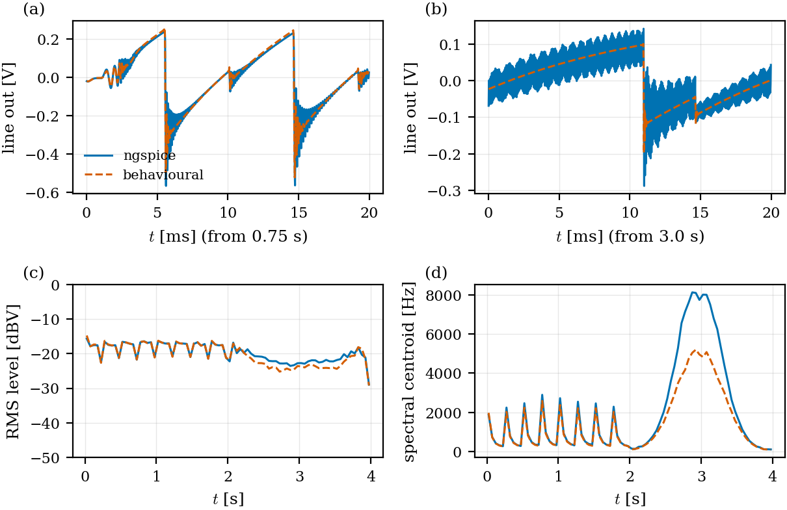
  <figcaption>Validation of behavioral model against ngspice simulation</figcaption>
</figure>

### Circuit details

I had limited prior experience with analog synthesizers and was quite amazed by some of the design choices. I reviewed the design in detail, but without changing anything. The [part selection](https://github.com/cpldcpu/TouchSynth/blob/master/parts/jlcpcb_basic_and_promotional_parts.csv) was fairly limited, which is why we see lots of components that would have also been used in the 70s - but I guess that is also fitting for an analog synthesizer.

<figure>
   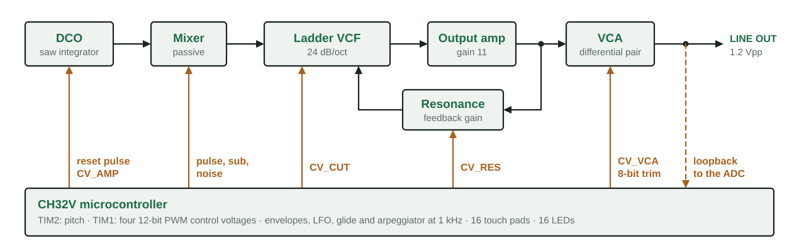
</figure>

The signal chain of the synthesizer is shown above. The basic idea is to have a frequency-tunable oscillator that creates a signal rich in harmonics. In this case this is an analog sawtooth oscillator. In addition, noise and square waveforms can be generated by directly using a digital output pin of the MCU (I later also experimented with direct digital synthesis for the oscillator using these pins). The oscillator signal is then passed through a low-pass filter with controllable resonance. The filter is a transistor ladder filter, which is a classic design that became famous in the Moog synthesizers. The output of the filter is then fed into a voltage-controlled amplifier (VCA), which is basically a variable-gain amplifier. 

#### DCO

<figure>
   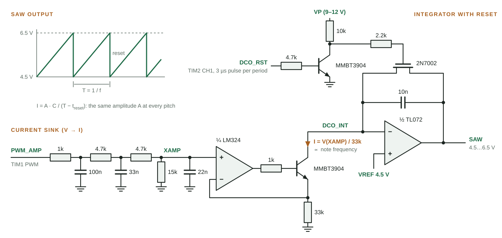
</figure>

The oscillator is basically a resettable integrator based on a 10 nF capacitor, a current sink and a reset switch. The reset switch is controlled by an MCU pin, which controls the pitch of the sawtooth signal. The current sink is controlled by a PWM output of the MCU with a passive low-pass filter and sets the slope. The LM324+transistor convert the voltage into a current. The AI correctly picked a low input leakage opamp for the integrator (TL072, limited by JLCPCB free part selection) and a 10 nF cap with high voltage rating (X7R, 50 V - no C0G available) to reduce nonlinearity.

#### Voltage-controlled filter

<figure>
   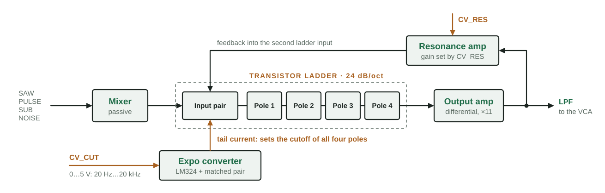
</figure>

The block diagram above shows the heart of the synthesizer, the transistor ladder filter along with control circuits. The mixer combines the oscillator signals. The ladder filter is a very steep (24 dB/oct) voltage-controlled low-pass filter, with a feedback branch that controls the resonance. 

<figure>
   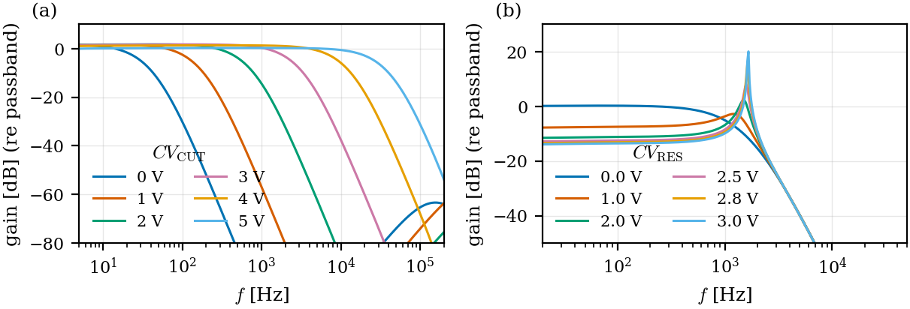
    <figcaption>Simulation of the ladder filter gain for different control voltages.</figcaption>
</figure>

<figure>
   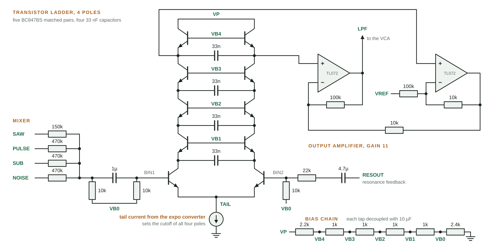
</figure>

The schematic of the ladder filter including mixer is shown above. It is constructed from matched NPN transistor pairs, which were luckily available in the parts library. Each of the ladder stages basically represents a single-pole low-pass filter, formed by the transistors' transconductance and the capacitor. The transconductance is proportional to the tail current, which can be used to control the cutoff frequency over the entire audio range. A much better explanation can be found in this series of articles: [1](https://www.allaboutcircuits.com/technical-articles/analyzing-the-moog-filter/) [2](https://www.allaboutcircuits.com/technical-articles/small-signal-open-loop-transfer-function-moog-filter/) [3](https://www.allaboutcircuits.com/technical-articles/characterizing-the-moog-filter/). The output of the ladder is picked up by an instrumentation amplifier formed from two opamps.

<figure>
   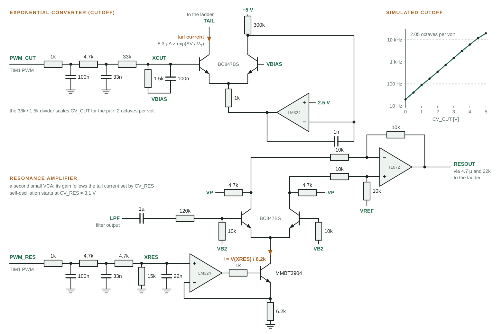
</figure>

To complete the filter, the tail current sink and resonance amplifier are also needed. The tail current has to be controlled over a wide range of currents (100s of nA to mA, 1:1400), which is why an exponential voltage-to-current converter is used here. The input voltage is again controlled with a PWM output. I suspect that this could have been simplified a bit.

The resonance amplifier is based on a differential pair, with tail current controlled by the MCU via PWM and a V-I converter. This circuit style certainly matches the Moog filter, but seems quite excessive. I suppose this is also owed to limited component selection as no OTA or JFET was available. The original Moog synthesizer simply used an analog potentiometer to control feedback ([see fig 5 here](https://www.allaboutcircuits.com/technical-articles/characterizing-the-moog-filter/)).

All in all I was extremely impressed with this section - manually designing and tuning a circuit like this would have taken quite a while. I would certainly have tried to take many more shortcuts, though.

#### Voltage-controlled amplifier

<figure>
   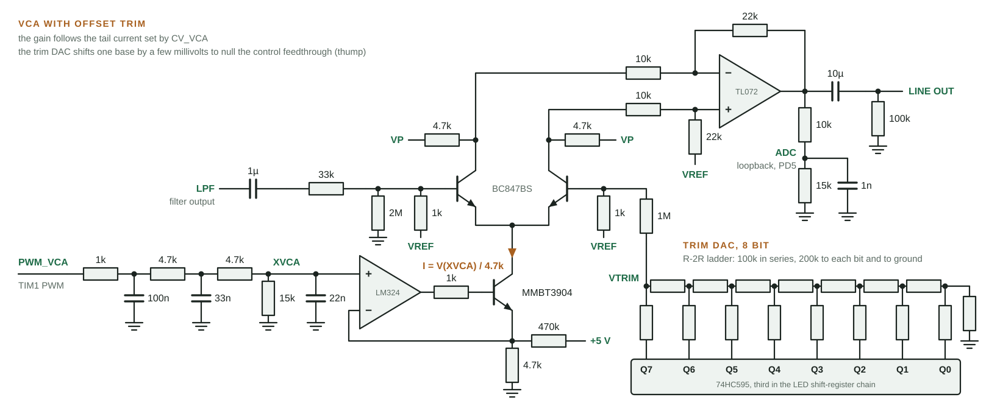
</figure>

The VCA is implemented with a tail-current-controlled differential pair. It also includes a trim DAC used to compensate for offsets generated by different settings in the ladder filter. Since no further PWM output was available, it is based on an R-2R ladder with a 74HC595 as driver. Again, a lot of components, but since these all only cost cents each it does not matter.

#### Rest of the design

Since pins were running out on the MCU, the touch keys and LEDs had to use pin extension with analog multiplexers (CD4051) and shift registers (74HC595). I also asked it to include a feedback path from the audio output to an ADC input of the MCU to enable automated bring-up. 

### Layout and sign-off

<figure>
   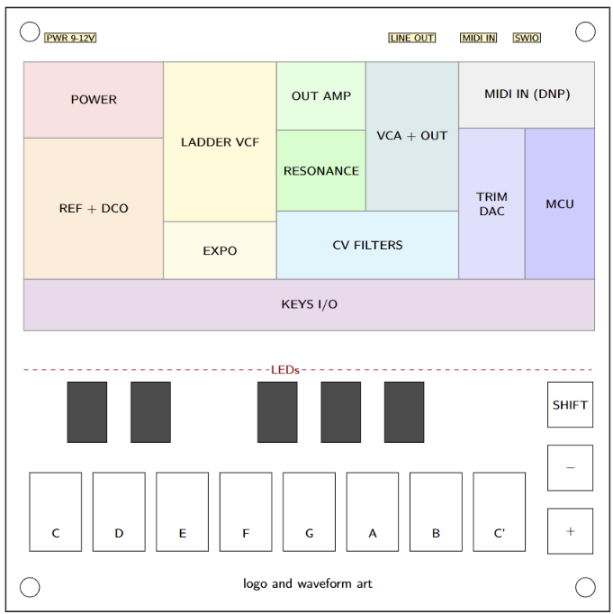
</figure>

The PCB layout was the part where I had to intervene most. The initial version had most analog components bunched up, but things improved significantly after I asked for a floorplan that follows the functional blocks. CC wrote Python programs for part placement and then used Freerouting to route the PCB. Two-layer routing failed, so I switched to four. It took a couple more iterations where I pointed out how to move circuit blocks around to make more space for routing channels until the routing finally cleared. Possibly this would have been easier if I had chosen a larger PCB area than 10 x 10 cm.

<figure>
   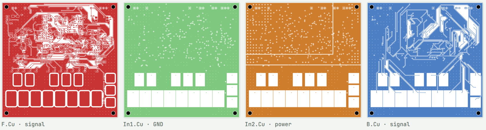
</figure>

Then I asked it to write the [firmware](https://github.com/cpldcpu/TouchSynth/blob/master/firmware/touchsynth/README.md), come up with a [bring-up plan](https://github.com/cpldcpu/TouchSynth/blob/master/docs/verification_plan.md) and prepare the ordering files.

According to the logs, the design took 19 hours from first prompt until ordering. Most of the time was spent on Freerouting runs that did not require any interaction.

| Time | Step | Result |
| --- | --- | --- |
| Sat 20:59 | First prompt | General KiCad/JLCPCB flow |
| 21:09 | Parts lists | Found the JSON API and saved 1,586 parts as CSV |
| 21:18–21:28 | Concept | Juno-style DCO, ladder VCF, written specification |
| 21:53–22:59 | Simulation | Seven ngspice test benches |
| 23:00 | Model | Behavioral model validated vs SPICE, audio samples  |
| 23:24–23:39 | Schematic |  KiCad sheets generated |
| 00:01–10:48 | PCB, 2 layers | Freerouting never fully routed |
| 10:48–15:18 | PCB, 4 layers | New stack-up and floorplan, fully routed, DRC clean |
| 16:04 | Order | Gerbers, BOM and placement file generated |

## Bring-up

The populated boards arrived after two weeks. After [first manual tests](https://github.com/cpldcpu/TouchSynth/blob/master/docs/verification_plan.md#3-l1--bring-up-mcu-not-fitted-then-fitted) before fitting the MCU, I connected the board to my lab PC via the MCU programmer and hooked up an oscilloscope to audio out (MSO5074, Ethernet). Claude Code controlled the lab PC through SSH. 

<figure>
   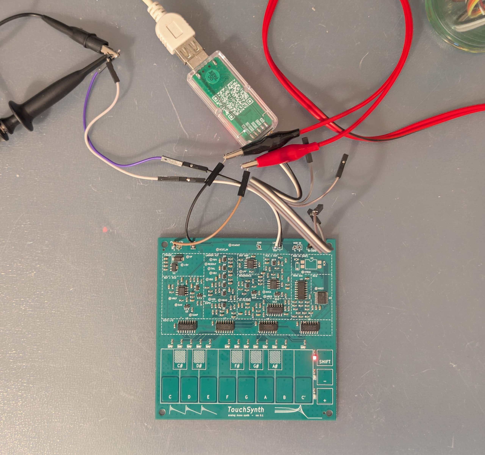
</figure>

All further bring-up was fully automated via the audio loopback to the microcontroller and the oscilloscope output. 

<figure>
   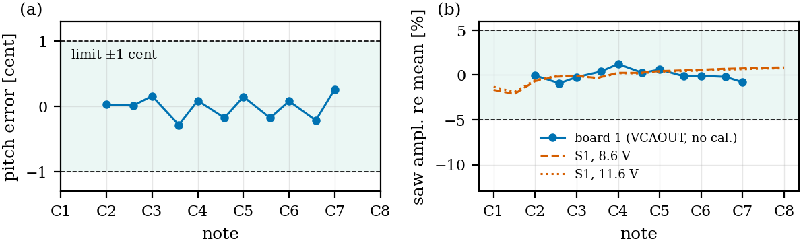
   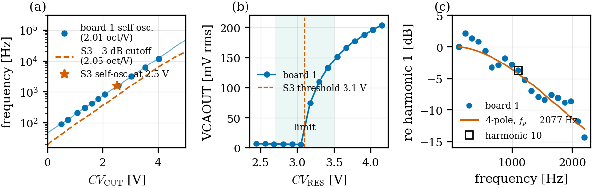
   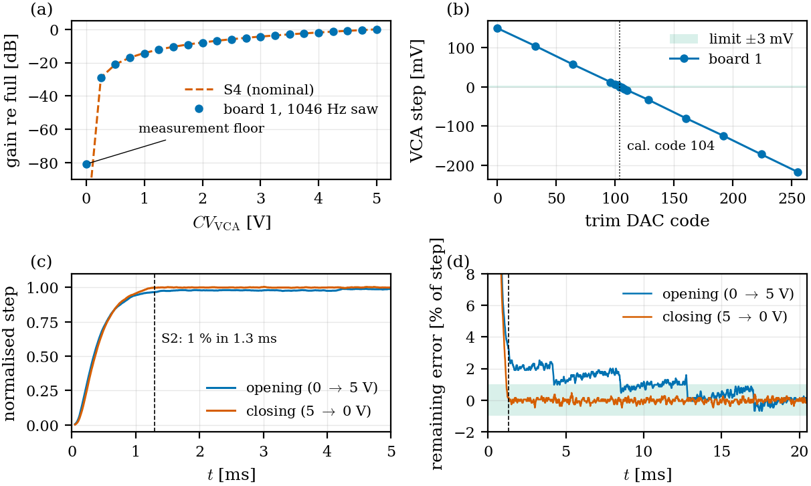
</figure>

The match between SPICE simulations (test benches S1-S4) and actual hardware (Board1) was excellent and the loopback allowed automated calibration of trimming and control parameters. This was surprising not only because the board was GenAI-developed, but also because matching of SPICE models for second-source components is not always that great. The only hardware fix required was to remove a solder bridge from the MCU, which I had soldered by hand...

The touch keys required recalibration, since they were initially too sensitive. Generally, they turned out to be rather hard to use due to their small size, so I opted to control the synthesizer directly via microcontroller programs.

The oscilloscope was also used to record the sound examples you can find on [this page](https://cpldcpu.github.io/TouchSynth/). These are automatically generated tracks from sheet music and other sources. Multiple voices are simulated by recording each voice separately and then combining them.

## Verdict

Can GenAI design complex mixed-signal circuits and implement them on a PCB? Absolutely. What do we make of it? Certainly this will soon require rethinking of design flows, similar to what is happening in software right now. I hope it will not make electronics less interesting...
